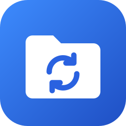
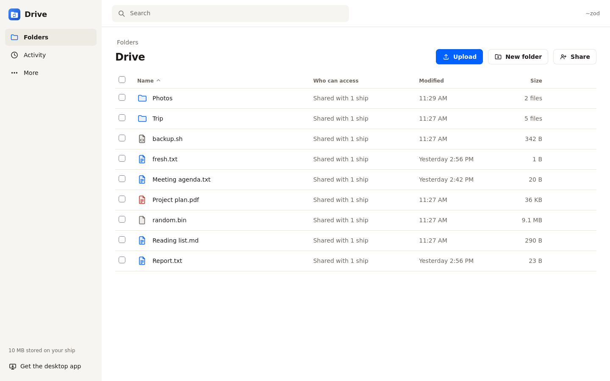
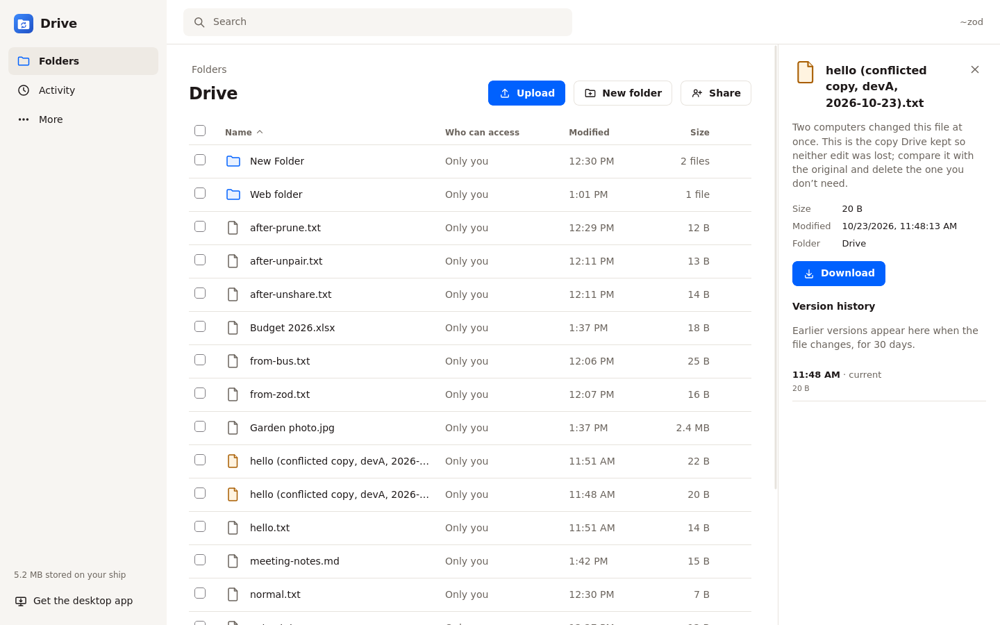
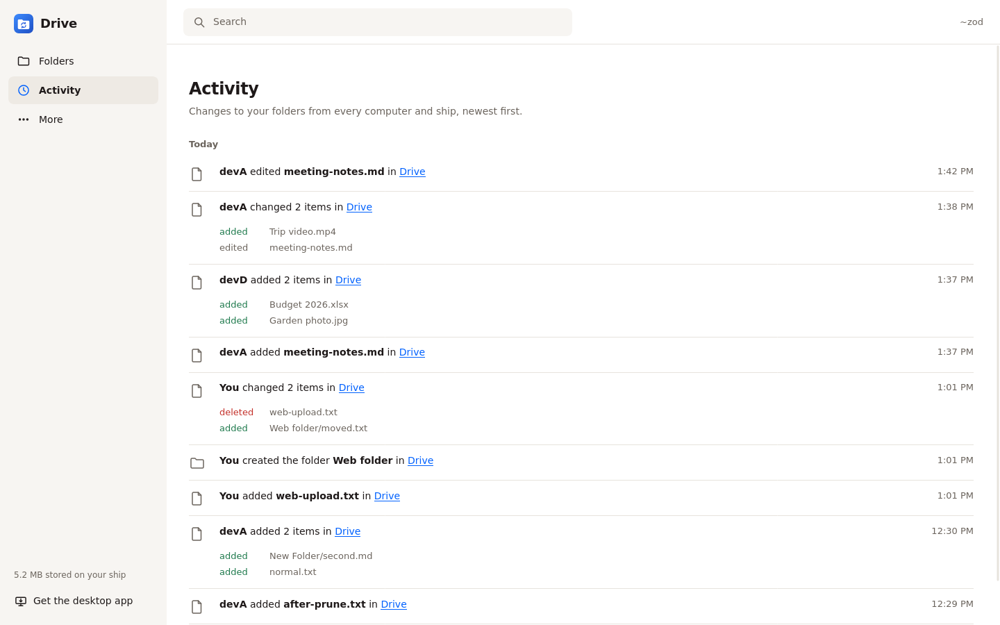
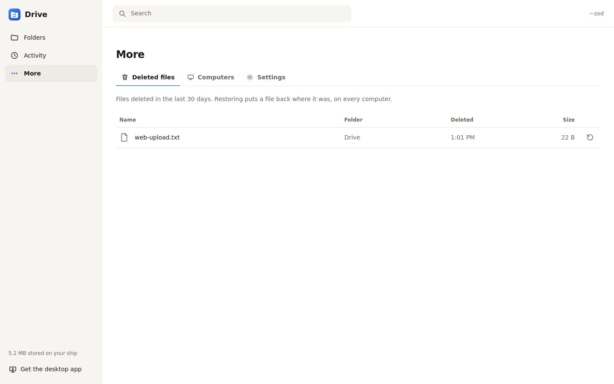
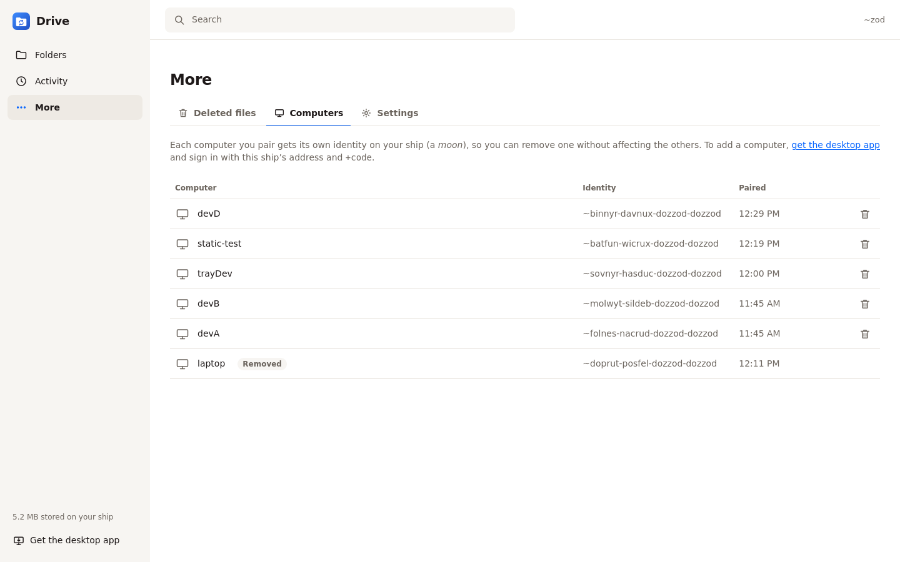
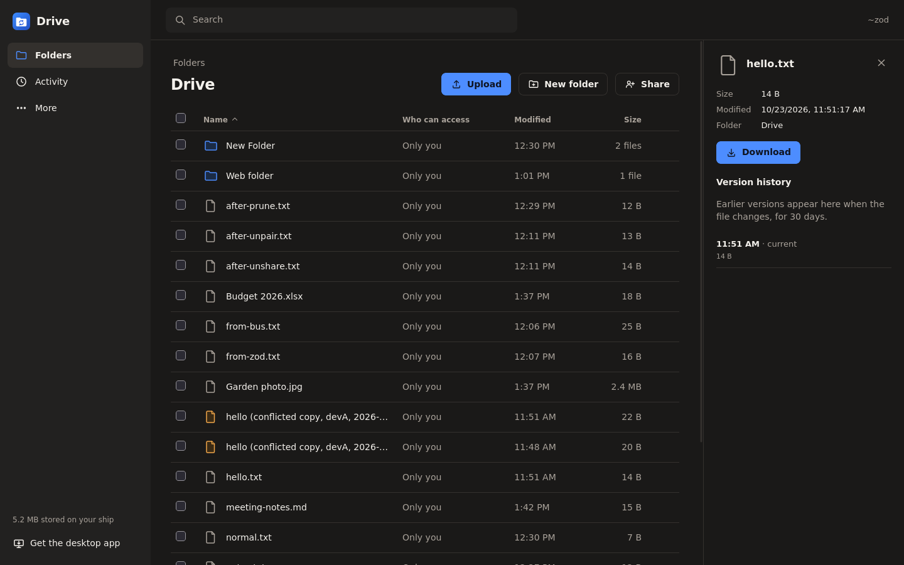
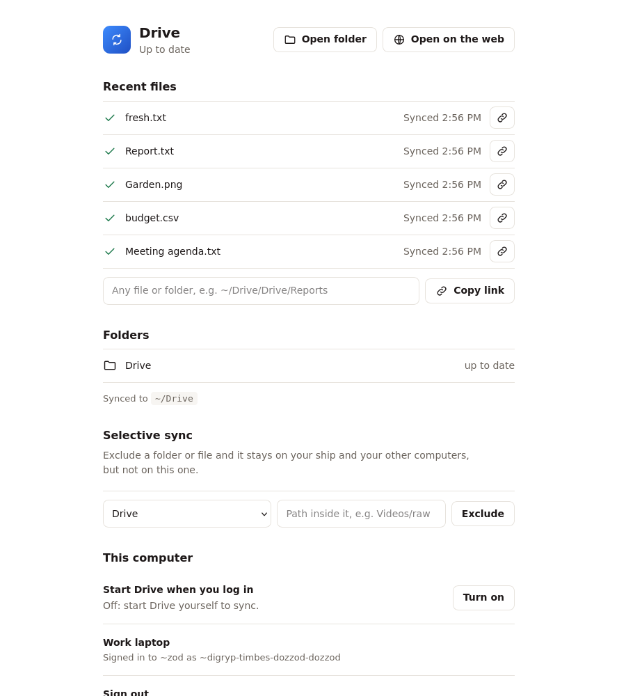
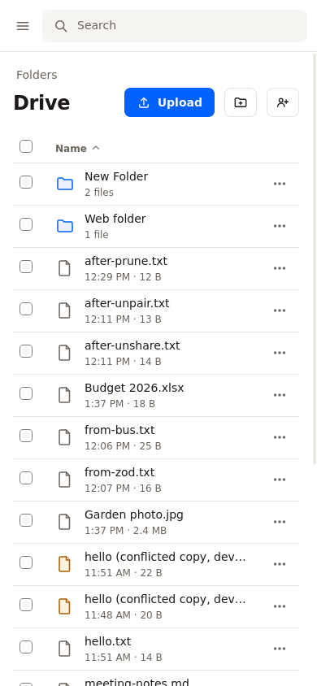
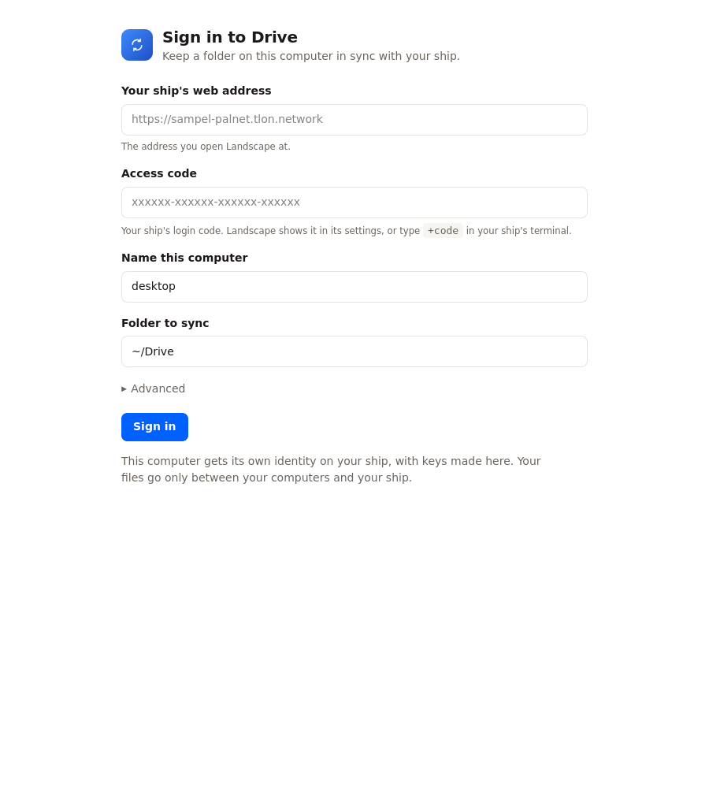

<p align="center"></p>

# Drive

Dropbox for your Urbit ship. Keep a folder in sync across your computers and share folders with friends' ships, with your own ship as the server. No company sits in the middle.

Each computer you sign in becomes a **moon** of your ship, with keys made on that computer. Files move only between your computers and your ship, over Urbit's mesa networking, and between your ship and the ships you share with.



## What it does

- **Sync a folder on every computer.** Install the desktop app (macOS, Windows, Linux), sign in with your ship's address and access code, and the folder syncs both ways.
- **A Dropbox-style web app on your ship.** Browse folders, upload, download, rename, move and delete, create folders, and search. It's a tile in Landscape.
- **Share folders with other ships.** Invite a ship with edit or view-only access. They get a copy on their ship and their computers, and edits flow both ways.
- **Never lose a file.** When two computers change a file at once, Drive keeps both side by side as a "conflicted copy". Deleted files and earlier versions stay restorable for 30 days by default.
- **See what changed.** Activity lists every edit, add and delete, from every computer and ship.
- **Selective sync.** Keep a big folder off a small laptop.
- **File status in the tray.** The menu shows which files are uploading, downloading, synced or in conflict.

## Screenshots

| | |
|---|---|
|  |  |
| Version history and conflicted copies | Activity across computers and ships |
|  |  |
| Deleted files you can restore | Your computers, each its own moon |
|  |  |
| Dark mode follows your system | The desktop app's settings page |

<p>


</p>

## Get it

**On your ship:** install the `%drive` desk. Until it's published from a distribution ship, install it from this repository. Create the desk (`|new-desk %drive`, `|mount %drive`), copy `desk/` into the mounted folder, then run `|commit %drive` and `|install our %drive`.

**On your computers:** download the desktop app from the [latest release](https://github.com/mopfel-winrux/urbit-drive/releases/latest) and open it. It asks for:

- your ship's web address (where you open Landscape);
- its access code (`+code` in your ship's terminal);
- a name for the computer, and the folder to sync.

If `%drive` isn't on your ship yet, the app can install it from a ship you name under **Advanced**.

## How it works

Your ship runs the `%drive` agent. It keeps each folder as a log of revisions and stores file contents as content-addressed chunks, so identical data is stored once. Each computer runs the desktop app, which is built on [libmesa](https://github.com/mopfel-winrux/libmesa) and speaks Urbit's mesa protocol natively as a moon of your ship.

- **Downloads** are encrypted remote scries of the revision log and its chunks.
- **Uploads** happen the other way round. Your computer publishes the new chunks, and your ship reads only the ones it doesn't have.
- **Sharing** reuses the same protocol between ships. A guest ship mirrors the owner's folder, and relays its own computers' changes back to the owner.

[PROTOCOL.md](PROTOCOL.md) has the full design: data model, namespace, conflict rules, sharing, retention and key rotation. [ROADMAP.md](ROADMAP.md) has what's next.

## Development

All you need is git, curl, tmux and a Go toolchain (any recent one; Go fetches the version `go.mod` asks for). The scripts fetch everything else the first time:

- **libmesa:** the git submodule `client/third_party/libmesa`, pinned to a commit.
- **zig 0.15.2:** downloaded into `client/build/` and checked against ziglang.org's published checksum, unless you already have that version.
- **vere:** the official urbit runtime, downloaded into `tools/.vere/`, unless `urbit` is on your PATH.

```sh
git clone --recursive https://github.com/mopfel-winrux/urbit-drive
cd urbit-drive

# a fake ~zod with the desk installed
tools/boot-fakezod.sh zod 8081 ./zod
tools/get-cookie.sh 8081 > .ship-cookie
tools/install-urbit-mcp.sh ./zod 8081 fake-zod zod   # the deploy loop's helper desk
tools/mcp.sh dojo/command '{"command":"|new-desk %drive"}'
tools/mcp.sh dojo/command '{"command":"|mount %drive"}'
tools/deploy.sh ./zod drive --install

# the desktop app
cd client
make                    # libmesa, zig if needed, then bin/drive
make test
./bin/drive pair -home /tmp/dev -dir /tmp/Drive -name laptop -fake \
    -url http://localhost:8081 -code lidlut-tabwed-pillex-ridrup
./bin/drive tray -home /tmp/dev   # tray and settings page; `drive run` for headless
```

`make dist-linux` and `make dist-windows-amd64` cross-build release archives. On a Mac, `make dist-darwin-arm64` builds the Mac ones. The release workflow builds them all on every `v*` tag.

## Status

v0.2, tested between fake ships (`~zod`, `~bus`) with several computers each. Not yet tried on the live network or on real Macs and Windows machines. Empty folders made on a computer, and symlinks, aren't synced yet.


## License

[MIT](LICENSE)
